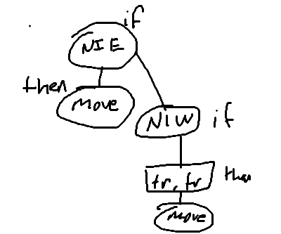
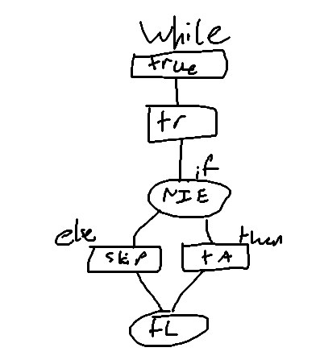
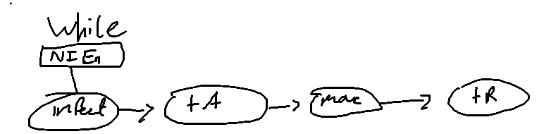
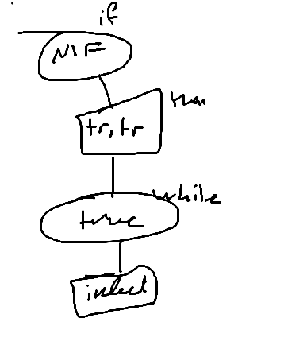
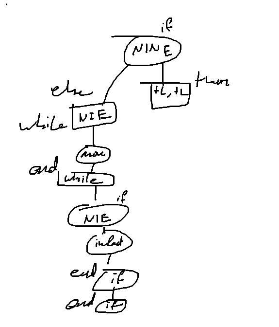

# [Homework 22: Statement and Recursion 1][hw22]

- **Andrew Bilyeu**: <!-- TODO: fill with first and last name (e.g., Brutus Buckeye) -->
- **bilyeu.14**: <!-- TODO: fill with OSU dot number (e.g., buckeye.17) -->
- **10/22 @1:50pm EST**: <!-- TODO: fill out with due date and time (e.g., 10/17 @ 3:10 PM EST) -->

## Preparation

Previous students would have wanted you to know the following
before you get started (based on 3 reviews):

- Estimated time to complete the assignment: 1.08 hours
- Most common emotion before starting the assignment: Hope (1 review)
- Most common emotion while completing the assignment: Enjoyment (1 review)
- Most common emotion after completing the assignment: Joy (1 review)

If the information above is incomplete, you can help by [providing
your own feedback][feedback-form] after completing this assignment.

## Problems

**This homework is necessary preparation for the lab.** Make sure you
type your answers in files you bring to the lab so that you will not
have to waste time entering your code during the lab.

### Problem 1

> Given the following BL statements, draw the corresponding abstract
> syntax trees as defined by the mathematical model of StatementKernel.
> See Slides 5-12 in Abstract Syntax Trees for some examples.
>
> **Note**: When drawing trees in markdown, it's okay not to adhere to the
> exact syntax you see in the slides. Our solutions make use of raw text
> trees, which you may recall seeing in [the heapsort homework][heapsort].
> You're also welcome to draw the trees and embed them as images in markdown,
> or you can even learn how to use diagram rendering tools like mermaid.

#### Problem 1A

```generic
IF next-is-empty THEN
    move
ELSE
    IF next-is-wall THEN
        turnright
        turnright
        move
    END IF
END IF
```

#### Problem 1B

```generic
WHILE true DO
    turnright
    IF next-is-enemy THEN
        TurnAround
    ELSE
        skip
    END IF
    turnleft
END WHILE
```


#### Problem 1C

```generic
WHILE next-is-enemy DO
    infect
    TurnAround
    move
    turnright
END WHILE
```


#### Problem 1D

```generic
IF next-is-friend THEN
    turnright
    turnright
    WHILE true DO
        infect
    END WHILE
END IF
```

#### Problem 1E

```generic
IF next-is-not-empty THEN
    turnleft
    turnleft
ELSE
    WHILE next-is-empty DO
        move
    END WHILE
    IF next-is-enemy THEN
        infect
    END IF
    skip
END IF
```

### Problem 2

> Using recursion, complete the body of the following static method.
> Note the use of a Java switch statement. See the Statement slides
> (44-49) for the syntax, purpose, and behavior of this construct.

```java
/**
 * Reports the number of calls to primitive instructions (move, turnleft,
 * turnright, infect, skip) in a given {@code Statement}.
 *
 * @param s
 *            the {@code Statement}
 * @return the number of calls to primitive instructions in {@code s}
 * @ensures <pre>
 * countOfPrimitiveCalls =
 *  [number of calls to primitive instructions in s]
 * </pre>
 */
public static int countOfPrimitiveCalls(Statement s) {
    int count = 0;
    switch (s.kind()) {
        case BLOCK: {
            /*
             * Add up the number of calls to primitive instructions
             * in each nested statement in the BLOCK.
             */
            int len = lengthOfBlock();
            for (int i = 0; i < len; i++)
                Statement callNum = s.removeFromBlock(i);
                count = count + countOfPrimitiveCalls(callNum);
                s.addToBlock(callNum);
            // TODO - fill in case
 
            break;
        }
        case IF: {
            /*
             * Find the number of calls to primitive instructions in
             * the body of the IF.
             */
 
            Statement ifNum = s.newInstance();
            Statement.Condition c = s.disassembleIf(ifNum);
            count = countOfPrimitiveCalls(ifNum);
            s.assembleIf(c, ifNum);
 
            break;
        }
        case IF_ELSE: {
            /*
             * Add up the number of calls to primitive instructions in
             * the "then" and "else" bodies of the IF_ELSE.
             */
 
            Statement ifC = s.newInstance();
            Statement elseC = s.newInstance();
            Statement.Condition c = s.disassembleIfElse(if, else);
            count = countOfPrimitiveCalls(ifC) + countOfPrimitiveCalls(elseC);
            s.assemble(c, ifC, elseC);

 
            break;
        }
        case WHILE: {
            /*
             * Find the number of calls to primitive instructions in
             * the body of the WHILE.
             */
 
            Statement whileC = s.newInstance();
            Statement.Condition c = s.disassembleWhile(whileC);
            count = countOfPrimitiveCalls(whileC);

            s.assembleWhile(c, whileC);
 
            break;
        }
        case CALL: {
            /*
             * This is a leaf: the count can only be 1 or 0. Determine
             * whether this is a call to a primitive instruction or not.
             */
 
            Statement callC = s.disassembleCall();
            if (callC.equals("move") || callC.equals("infect")
                       || callC.equals("turnright") || callC.equals("turnleft")
                       || callC.equals("skip")) {
                   count++;
               }
               s.assembleCall(label);
 
            break;
        }
        default: {
            // this will never happen...can you explain why?
            Is it because the first switch in the series contains all the possible
            cases so that the program never goes to the default?
            break;
        }
    }
    return count;
}
```

## Submission

If you have completed the assignment using this template, VS Code should
automatically convert the template to a PDF on save. If you're not automatically
getting a PDF, please reach out to the instructor. If you're in a rush to
submit, you may use one of the alternative strategies described in this
[Markdown to PDF guide][markdown-to-pdf-guide]. You may also consider printing
the raw markdown directly. However, do not make a habit of this as the graders
reserve the right to give a zero.

[hw22]: https://cse22x1.engineering.osu.edu/2231/assignments/homeworks/statement1.html
[feedback-form]: https://forms.gle/qJ1gEM5N1r6X7Poy5
[markdown-to-pdf-guide]: https://therenegadecoder.com/blog/how-to-convert-markdown-to-a-pdf-3-quick-solutions/
[heapsort]: https://cse22x1.engineering.osu.edu/2231/assignments/homeworks/heapsort.html
